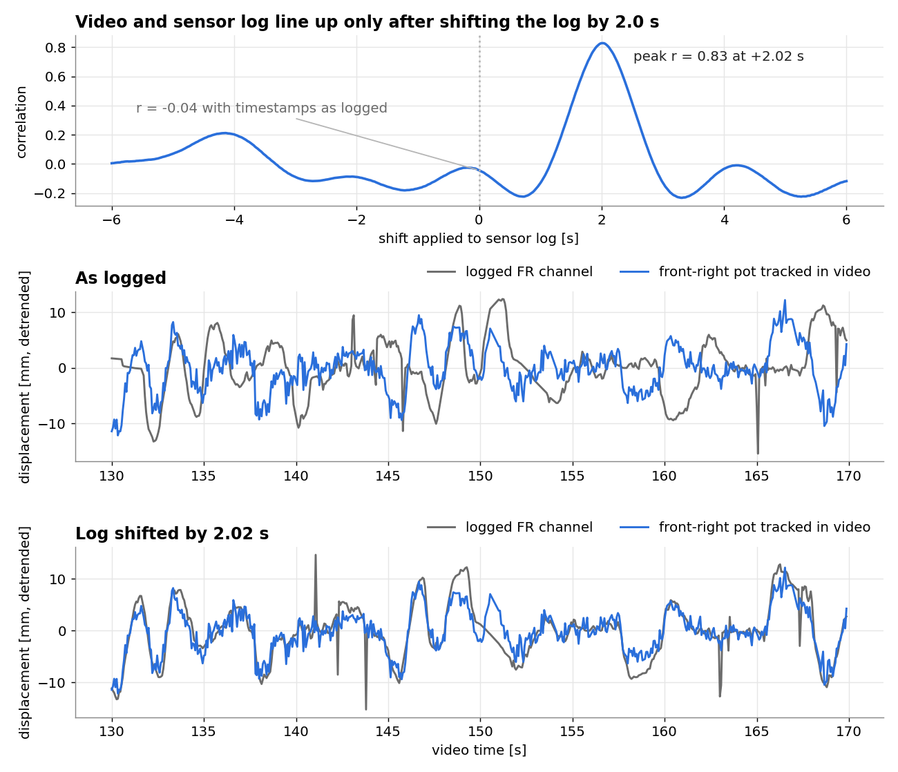
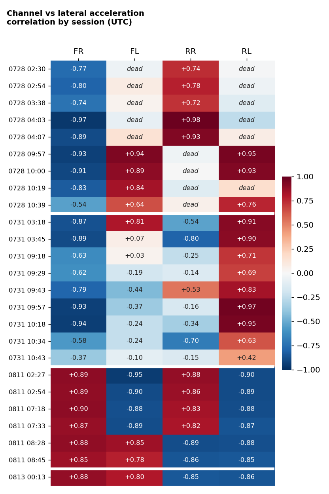
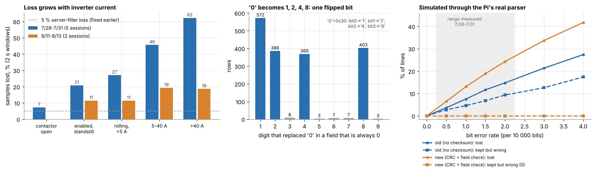
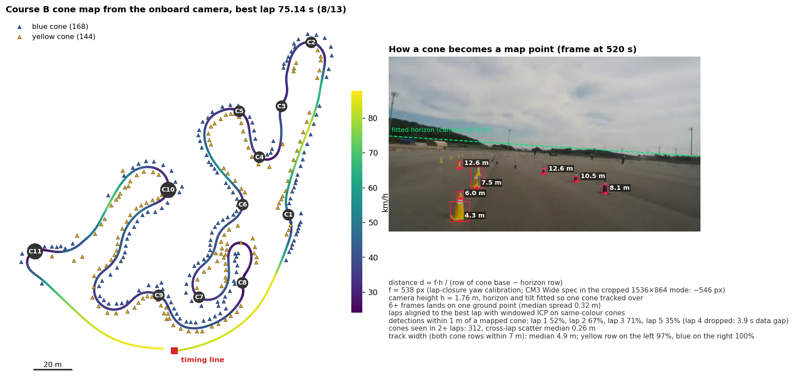

# 주행 로그 후처리: 영상으로 계측 시스템 검증하기

2026년 7~8월 주행 로그(세션 25개, 약 178만 행)와 온보드 영상(15개, 854×480, 15fps)만으로 계측 시스템을 검증하고, 찾은 결함을 코드까지 추적해 고쳤다. 추가 센서나 차량 재시험은 쓰지 않았다.

## 핵심 결과

| 항목 | 결과 |
| --- | --- |
| 영상–로그 동기 오차 | 세션마다 0.6~2.0초. 세션 안에서는 ±0.03초로 일정 |
| 채널 오류 | 8/11 오후부터 FL↔RR 라벨 뒤바뀜, 7/31 03:45 세션 6분 7초에 FL 고장 |
| 주기적 샘플 손실 5% | 원인은 서버 로그 저장 필터. 수정 후 재현 테스트 손실 0 ([log_downsample.py](../server/udp_logger/log_downsample.py)) |
| 전송 실패 손실 | Pi가 실패한 배치를 버림. 재전송 추가 후 2초 단절 모의에서 200 → 0 샘플 |
| 버스트 손실 (최대 60%대) | 원인은 STM→Pi UART의 비트 오류. 인버터 전류가 클수록 늘고, 체크섬이 없어 손상된 값이 그대로 기록됨. CRC-16과 줄 검사 추가 후 모의에서 틀린 값 수용 0 |
| 카메라 요레이트 | 랩 닫힘 조건으로 자기 교정. 6랩 적분 오차 30~192m → 18~27m |
| 코스와 랩 타임 | GPS 없이 코스 2개, 41랩 계측. 최고 38.66초(약 495m), 75.14초(약 898m) |
| 콘 지도 | 깊이 센서 없이 8/13 영상에서 콘 312개 위치 복원. 랩 간 산포 중앙값 0.26m, 트랙 폭 중앙값 4.9m |
| 차량 특성 | 롤 1.2~1.3 deg/g(영상), 언더스티어 K 0.0034~0.0044 s²/m² |
| 전류 센서 | 인버터 전류가 BMS 전류의 1.22~1.30배. BMS 자체 용량 카운터는 두 적분 사이(합계 0.87배 / 1.10배)라 판정 불가 |
| 서스펜션 2Hz 이상 | 펌웨어 필터는 ±0.15mm로 역산되지만, 그 대역은 정차 중 잡음과 주행 중 신호가 비슷한 크기 |

---

## 1. 영상을 기준선으로 로그 검증

온보드 카메라에 전륜 리니어 포텐셔미터가 찍혀 있어서, 영상을 로그와 독립된 두 번째 측정으로 썼다.

양 끝 초록 부품 네 개의 중심을 찾고, 같은 포텐셔미터의 두 마커 사이 픽셀 거리를 변위 대용값으로 쓴다. 차체에 고정된 안쪽 두 마커의 간격이 2px 넘게 변한 프레임은 버린다.


영상 변위와 로그 변위를 시간으로 옮겨 가며 교차상관하면, 타임스탬프 그대로는 상관 −0.04이고 로그를 2.02초 옮기면 0.83이다.



채널별 횡가속도 상관의 부호를 세션마다 추적하면 죽은 채널, 고장, 부호 반전, 라벨 뒤바뀜이 날짜별로 드러난다. FL 고장 시점은 [fig2](figures/fig2_fl_failure.png), 라벨 교정 전후 롤 응답은 [fig4](figures/fig4_roll.png).



## 2. 샘플 손실의 원인 규명과 수정

1. 손실을 주기적 손실(약 5%, 정지 중에도 동일)과 버스트 손실(0~53%)로 나눴다. 버스트 손실은 같은 회전수에서 타행 중 2~5%, 구동 중 12~60%로 구동 전류를 따랐다.
2. 주기적 손실은 정확히 200ms마다, 항상 '11ms 뒤 19ms' 간격으로 나타났다.
3. 펌웨어가 200ms마다 MCU 온도를 읽어 그 샘플이 1ms 늦게 찍힌다.
4. 서버 저장 필터가 직전 행보다 10ms 미만 뒤에 온 행을 버려서, 늦은 샘플 다음의 정상 샘플(9ms 간격)이 사라졌다.
5. 필터에 지터 허용치를 넣고 독립 모듈로 분리했다. 펌웨어 타이밍을 재현한 테스트에서 수정 전에는 로그와 같은 무늬로 5.0% 손실, 수정 후 0이다.

Pi는 전송에 실패한 배치를 버렸다. 보관했다가 순서대로 재전송하도록 고쳤다. 테스트: `server/udp_logger/test_log_downsample.py`, `device/raspberry pi 5/test_batch_sender.py`.


### 남은 버스트 손실: UART 비트 오류

주기적 손실과 전송 실패를 고친 뒤에도 7/28~7/31 세션은 손실이 10~48%였다. Pi가 새로 보내던 순번 컬럼(`batch_seq`, `uart_rx_mono_ns`)은 7/27 이후 비어 있어서, 로그에 남은 값 자체로 원인을 추적했다.



1. **손상된 값이 기록돼 있다.** Pi 파서는 체크섬이 없고, 필드가 모자라면 0으로 채워 받는다. 그래서 x_g 255.9g, 모터 30만 rpm 같은 값과 필드가 한 칸씩 밀린 행이 로그에 남았다.
2. **단일 비트 오류다.** 이 차에서 항상 0인 필드(`INV_shudder_torque` 등)에 찍힌 숫자를 세면, 1758건 중 98.4%가 1·2·4·8이다. ASCII '0'(0x30)의 하위 비트 하나가 뒤집히면 정확히 이 네 숫자가 된다. 소프트웨어 버그나 바이트 유실로는 이런 분포가 나오지 않는다.
3. **인버터 전류를 따른다.** 2초 구간별로 보면 7/28~7/31 손실이 접촉기 개방 7%, 정차 대기 21%, 저전류 주행 27%, 5~40A 46%, 40A 초과 62%다. 손상 행 비율도 같이 오른다. 세션 간 손상 행 비율과 버스트 손실의 순위상관은 0.84(7/28 이후 30개 세션)다. 고전압을 켜지 않은 7/21~7/25 벤치 세션 4개는 손실 0, 손상 행 1000행당 0.04 이하였다.
4. **8/11부터 크게 줄었다.** 같은 40A 초과 구간에서 손실 19%, 손상 행 비율은 1000행당 21.6 → 3.6으로 약 1/6이다. 그 사이 무엇이 바뀌었는지(배선, 접지, 차폐)는 로그로 알 수 없다.
5. **모의로 크기를 확인했다.** 로그 행을 펌웨어 자릿수 그대로 줄로 다시 만들고, 비트 오류를 넣어 Pi의 실제 파서에 통과시켰다(`uart_sim.py`). 세션별로 잰 비트 오류율(최대 약 3×10⁻⁴)에서 독립 오류만으로는 손실이 15~22%로, 실제 28~41%의 절반가량이다. 나머지는 오류가 몰려서 오는 경우(노이즈 버스트)로 보이며, 확정은 아니다. 비트 오류율이 가장 높은 세션 수준(2~3×10⁻⁴)에서는 같은 모의에서 기록된 행의 9~13%에 틀린 값이 섞였다.

**클럭 여유:** UART4는 HSI(내부 RC)에서 만든 APB1 42MHz를 쓴다. HAL 분주 계산으로 921600 설정의 실제 속도는 933,333Bd(+1.27%)다. 460800이면 분주 오차는 +0.16%다. HSI 자체 오차(25°C에서 ±1%)가 더해져 수신 여유가 줄어든다. 다만 오류가 하위 비트 0~3에 고르게 나타나서, 클럭 오차보다 노이즈가 주 원인으로 보인다. `.ioc`에는 8MHz HSE 핀이 설정돼 있지만 클럭 소스는 HSI다.

**수정 (재현 테스트로만 확인):**
- 펌웨어(`sensor_uart.c`, `line_crc.h`)가 줄 끝에 `,*XXXX`(CRC-16/CCITT-FALSE)를 붙인다. 구 Pi 파서는 남는 필드를 버리므로 배포 순서와 무관하게 동작한다.
- Pi(`Uart_stm.py`)에 `LineGuard`를 넣었다. CRC가 틀리면 버리고, 한 번 CRC를 보면 꼬리 없는 줄도 버린다. 필드 수를 고정해 잘린 줄이나 붙은 줄을 0 채움 없이 버리고, 버린 이유를 상태 출력에 센다.
- 테스트: `device/raspberry pi 5/test_uart_line_guard.py` 9개. 펌웨어 헤더를 gcc로 컴파일해 Python CRC와 대조하고, 비트 오류율 3×10⁻⁴에서 구 파서는 틀린 행 50개 넘게, 새 경로는 0개를 받는지 확인한다.
- 대가: 틀린 행을 버리는 만큼 기록되는 행은 줄어든다(모의에서 손실 15% → 24%, 비트 오류율 2×10⁻⁴). 손실 자체는 하드웨어에서 막았어야 했다. 배선을 트위스트·차폐하고 인버터·모터 케이블에서 떼고, 보드레이트를 낮추거나 HSE를 쓰고, 줄을 짧게(이진 형식) 만들었어야 했다. 차와 장비는 더 다룰 수 없어 이 수정들은 실차에 적용하지 못한 참고 구현으로 남는다.

## 3. 카메라를 없는 센서 대신 쓰기

전방 카메라의 지평선 띠(행 170~310)에서 프레임 간 좌우 이동으로 요레이트를, 좌우 절반의 상하 이동 차이로 롤 변화를 잰다.


- **자기 교정:** 한 랩을 돌면 방향각은 정확히 한 바퀴라는 조건만으로 픽셀당 각도를 구했다(랩당 화면 이동량 변동계수 1.7%). 결과는 초점거리 538px다.
- **사양 대조:** 카메라는 Camera Module 3 Wide(초점거리 2.75mm, 화소 1.4µm, 가로 화각 102°)다. 1536×864 크롭 모드(2×2 비닝)를 854×480으로 줄였다고 보면 예상 초점거리는 546px로, 자기 교정값과 1.5% 차이다. 전체 화각 모드(2304×1296)였다면 364px여야 하므로, 녹화는 크롭 모드로 화각 약 79°만 쓴 것으로 보인다. 다음 녹화에서 `--mode 2304:1296`을 지정하면 102°를 쓸 수 있다(실차 미확인).
- **성능:** 랩별 보정 없이 6랩을 적분한 닫힘 오차가 가속도 기반 30~192m에서 카메라 기반 18~27m로 줄었다.
- **차량 특성:** 정상선회 모델로 언더스티어 계수 0.0034~0.0044 s²/m²(특성 속도 54~62km/h, [fig11](figures/fig11_yawgain.png)), 지평선 기울기로 차체 롤 1.2~1.3 deg/g를 구했다. 조향 센서 영점이 세션마다 −21~+13° 다른 것도 이때 드러났다.


## 4. 코스와 랩 타임 (GPS 없이)

1. 차속과 횡가속도로 곡률을 구해 0.5m 간격 거리축에 놓는다.
2. 곡률 자기상관의 최대에서 랩 길이를 찾는다.
3. 다음 랩과 가장 잘 맞는 랩을 기준으로, 곡률과 속도 무늬를 세션 전체에 대어 랩 경계를 찾는다.
4. 기준선을 메인 직선의 최고속 지점으로 고정하고, 나가고 들어오는 랩(중앙값의 112% 초과)과 데이터 공백 2.5초 초과 랩은 뺀다.
5. 같은 코스 판정은 한 랩 속도 무늬의 일치도로 했다(7/31 두 세션 0.95, 8/11–8/13 0.76).


| 코스 | 랩 길이 | 방향·코너 | 계측 랩 | 최고 랩 | 이론상 최고 |
| --- | --- | --- | --- | --- | --- |
| A (7/31) | ~495 m | 반시계, 5개 (모두 좌) | 36 (03:18 20, 03:45 16) | 38.66 s | 37.95 s |
| B (8/11·8/13) | ~898 m | 반시계, 11개 (좌 8, 우 3) | 5 (8/11 1, 8/13 4) | 75.14 s | 73.88 s |

이론상 최고는 코너 구간별 최고 기록의 합이다.


| 세션 | 랩 | 최고 | 중앙값 | 표준편차 | 랩당 에너지 | 배터리 최고 온도(끝) |
| --- | --- | --- | --- | --- | --- | --- |
| A 7/31 03:18 | 20 | 41.62 s | 45.24 s | 3.00 s | 76 Wh | 37 °C |
| A 7/31 03:45 | 16 | 38.66 s | 39.78 s | 0.59 s | 89 Wh | 46 °C |
| B 8/11 08:45 | 1 | 84.80 s | – | – | 180 Wh | 40 °C |
| B 8/13 00:13 | 4 | 75.14 s | 77.78 s | 1.53 s | 177 Wh | 33 °C |

- 코스 A는 같은 날 두 번째 세션에서 중앙값 12% 단축, 편차 3.00 → 0.59 s. 03:45 후반에는 0.5~1.5 s 느려졌고, 그동안 배터리 온도 39 → 46 °C, 랩당 에너지 약 92 → 85 Wh. 원인은 가르지 못했다.
- 코스 B는 8/11 84.8 s → 8/13 75.14 s (−11%).


| 코스·코너 | 위치 | 방향 | 반경 | 진입→최저→탈출 (km/h) | 최대 횡 g | 평균−최고 |
| --- | --- | --- | --- | --- | --- | --- |
| A C1 | 51 m | 좌 | 19 m | 75 → 48 → 55 | 1.28 | 0.37 s |
| A C2 | 118 m | 좌 | 11 m | 61 → 44 → 67 | 1.51 | 0.14 s |
| A C3 | 227 m | 좌 | 5 m | 75 → 26 → 31 | 1.37 | 0.37 s |
| A C4 | 307 m | 좌 | 9 m | 36 → 26 → 46 | 1.46 | 0.64 s |
| A C5 | 398 m | 좌 | 9 m | 56 → 32 → 73 | 1.46 | 0.24 s |
| B C1 | 106 m | 좌 | 17 m | 84 → 39 → 78 | 1.18 | 0.43 s |
| B C2 | 206 m | 좌 | 8 m | 82 → 31 → 39 | 1.14 | 0.33 s |
| B C3 | 248 m | 우 | 12 m | 39 → 30 → 35 | 0.95 | 0.53 s |
| B C4 | 285 m | 우 | 7 m | 36 → 28 → 38 | 1.11 | 0.16 s |
| B C5 | 313 m | 좌 | 9 m | 38 → 29 → 45 | 0.93 | 0.17 s |
| B C6 | 384 m | 우 | 11 m | 57 → 36 → 42 | 1.09 | 0.23 s |
| B C7 | 445 m | 좌 | 8 m | 45 → 29 → 35 | 1.05 | 0.34 s |
| B C8 | 516 m | 좌 | 9 m | 35 → 23 → 44 | 1.00 | 0.15 s |
| B C9 | 584 m | 좌 | 9 m | 44 → 31 → 38 | 1.10 | 0.22 s |
| B C10 | 698 m | 좌 | 8 m | 55 → 30 → 64 | 1.12 | 0.18 s |
| B C11 | 800 m | 좌 | 6 m | 64 → 25 → 84 | 1.20 | 0.65 s |

랩 타임이 가장 흔들리는 코너는 B C11(메인 직선 직전), A C4, B C3. 제동 g까지 포함한 전체 표는 `results/corners_courses.csv`, 랩별 값은 `results/laps_courses.csv`.

## 5. 카메라로 콘 지도 만들기 (깊이 센서 없이)

8/13 주행장은 평평한 포장 부지에 파랑·노랑 콘을 세운 코스다. 바닥이 평평하면 콘 밑동이 화면 몇 번째 행에 있는지만으로 거리가 정해진다: d = f·h / (밑동 행 − 지평선 행). 깊이는 차가 움직이며 같은 콘을 여러 위치에서 보는 것으로 확인한다.



1. **콘 검출:** 노랑은 채도·밝기, 파랑(짙은 남색)은 색상과 낮은 밝기로 찾는다. 흰 띠로 위아래가 나뉜 콘은 하나로 합친다. 15m 안에서 프레임당 약 4개가 잡힌다.
2. **카메라 교정:** 카메라 높이, 지평선 행, 고정 기울기, 가감속·횡가속에 따른 피치·롤을 맞췄다. 기준은 한 콘을 6프레임 이상 추적했을 때 모든 프레임이 같은 바닥점에 떨어지는 것이다(콘 449개 추적, 추적 내 산포 중앙값 0.32m). 결과는 높이 1.76m, 기울기 3.8°.
3. **랩 정렬:** 차속과 카메라 요레이트로 적분한 랩별 궤적은 랩마다 2~3m 어긋난다. 최고 랩(75.14초)의 콘에 나머지 랩을 같은 색 콘끼리 3초 구간별 ICP로 맞추고, 그 보정을 궤적에도 적용했다. 랩 4는 데이터 공백(3.9초)으로 뺐다.
4. **결과:** 2랩 이상에서 확인된 콘 312개(파랑 168, 노랑 144), 4랩 모두에서 88개. 같은 콘의 랩 간 산포는 중앙값 0.26m, 90%가 0.41m 이내다. 노랑 콘은 주행 방향 왼쪽(97%), 파랑은 오른쪽(100%)에 있어 좌우 부호와도 맞는다.

| 코너 | 방향 | 최고 랩 최저속 | 정점에서 안쪽 콘 줄까지 | 트랙 폭 |
| --- | --- | --- | --- | --- |
| C1 | 좌 | 40 km/h | 0.6 m | 3.1 m |
| C2 | 좌 | 30 km/h | 1.5 m | 6.1 m |
| C4 | 우 | 28 km/h | 2.8 m | 6.5 m |
| C5 | 좌 | 30 km/h | 2.2 m | 4.5 m |
| C6 | 우 | 36 km/h | 2.3 m | 4.9 m |
| C7 | 좌 | 30 km/h | 2.3 m | 6.6 m |
| C9 | 좌 | 32 km/h | 2.1 m | 6.2 m |
| C10 | 좌 | 30 km/h | 0.4 m | 4.0 m |
| C11 | 좌 | 25 km/h | 3.0 m | 4.0 m |

거리는 카메라 축(차 중심선) 기준이다. C3, C8은 한쪽 콘 줄이 지도에 없어 뺐다. 여러 코너에서 차 중심이 안쪽 콘 줄에서 2~3m 떨어져 지나갔다(차 반폭 약 0.7m 가정 시 여유 1.3~2.3m). 라인을 더 안쪽으로 잡을 여지로 보이지만, 정렬 오차가 0.3~0.5m 있고 콘 사이 간격으로 지나갈 수 있는 경우가 섞여 있어 확정은 아니다.

## 6. 남은 데이터로 더 확인한 것

### 펌웨어 필터 역산: 수학적으로는 복원되지만 2Hz 이상은 잡음

펌웨어는 ADC 정수값에 `ema += ((raw - ema) * 32) >> 8`을 샘플마다 건다(`adc.c`). 한 스텝의 변화가 floor((raw−ema)/8)이므로, 연속한 두 샘플이 있으면 raw를 ±3.5카운트(약 ±0.15mm) 안으로 되돌릴 수 있다(`ema_inverse.py`). 7/31 세션은 연속 샘플 쌍이 78~91%라 대부분 복원된다.

- **영상과 맞는 대역에서는 맞다:** 0.5~2Hz에서 복원값의 영상 대비 진폭은 로그값의 1.03~1.14배다. 필터를 되돌렸을 때의 이론값 1.17배와 비슷하다(전륜 우측, 세션 5개, 주행 중).
- **2Hz 이상은 확인할 수 없다:** 그 대역에서 영상과의 응집도가 0.01~0.07로, 영상(15fps, 추적 잔차 약 2.4mm)으로는 검증이 안 된다.
- **복원된 신호의 대부분은 잡음이다:** 2~7Hz 성분의 RMS가 정차 중 0.11~0.41mm, 주행 중 0.32~0.52mm다. 차가 서 있을 때와 달릴 때의 차이가 작아, 이 대역에서 실제 움직임과 전기적 잡음의 크기가 비슷하다. 펌웨어 필터는 이 잡음을 가리고 있었다.
- **결론:** 원시값을 기록했더라도 댐퍼 분석은 어려웠다. 아날로그 단의 잡음(필터, 차폐, 접지)부터 낮췄어야 했다.

### BMS 남은 용량으로 본 전류 센서

BMS가 CAN으로 보내는 남은 용량(`bms_capacity`)은 펌웨어가 ×1로 읽어 121~176이 기록됐다. 0.1Ah 단위로 보면 세션 동안의 감소량이 적분 전류와 같은 크기가 된다. 그래서 0.1Ah 단위를 펌웨어가 잘못 읽은 것으로 본다(추정). SOC 필드(`bms_charge`)는 전 세션에서 0으로, 해석되지 않았다.

| 세션 | 남은 용량 감소 | BMS 전류 적분 | 인버터 전류 적분 |
| --- | --- | --- | --- |
| 8/11 07:33 | 0.9 Ah | 0.89 Ah | 1.13 Ah |
| 8/11 08:28 | 2.2 Ah | 1.65 Ah | 2.09 Ah |
| 8/11 08:45 | 1.4 Ah | 1.36 Ah | 1.70 Ah |
| 8/13 00:13 | 5.3 Ah | 4.61 Ah | 5.83 Ah |

네 세션 합계로 BMS 적분은 감소량의 0.87배, 인버터 적분은 1.10배다. BMS의 용량 카운터는 BMS 자신의 전류 센서로 세는 값이라 독립 기준이 아니고, 해상도도 0.1Ah다. 그래서 어느 센서가 맞는지는 여전히 판정할 수 없다. 다만 BMS가 센 방전량은 두 적분 값 사이에 있다.

### 기록된 값의 비트 오류 걸러내기

7/28~7/31 로그의 남은 행에도 비트 오류로 틀린 값이 섞여 있다(2절). 한 샘플만 튀고 앞뒤 샘플은 서로 같은 값을 찾아 지웠다(`scrub.py`, `scrub_apply.py`).

- **물리적으로 불가능한 채널만 지운다:** 포텐셔미터(펌웨어 EMA는 한 샘플만 튀었다 돌아올 수 없다), 온도·전압(느린 신호), CAN 구동값(프레임을 받을 때까지 값이 유지된다)이 대상이다. 가속도계는 실제 충격일 수 있어 남긴다. 두 행 이상 이어진 손상은 물리 한계(예: 모터 7000rpm, 모터 온도 150°C)로 거른다.
- **비트 오류를 잡는지 확인했다:** 느린 채널에서 찾은 튐의 23~25%가 정확히 1·2·4·8×10ᵏ 크기였다. 우연히 그 크기가 될 확률은 약 1%다. 세션별 튐 비율과 2절의 비트 오류율은 순위상관 0.76(28개 세션)이다.
- **결과:** 30개 세션 117만 행에서 값 21,134개를 지웠다(세션별 1000행당 0~56개). 예를 들어 7/31 03:45의 FR 최대값은 5002 → 34mm, 모터 회전수 최대값은 329,886 → 3,559rpm이 됐다. 지운 위치는 `clean/scrub_masks/`에 남긴다.
- **결론이 바뀌는지 확인했다:** `AFA_SCRUB=1`로 정제를 켠 복사본에서 전체 파이프라인(정제 → 랩 → 코너 → 롤 → 언더스티어 → 파워트레인)을 다시 돌렸다. 정제를 켜면 필드 두 개 이상이 걸린 행은 밀린 줄로 보고 통째로 버린다. 비교는 `compare_scrubbed.py`로 했다.
  - 코스 B(8/11~8/13)는 모든 값이 같았다. 언더스티어 K(0.0044 / 0.004)도 같고, 롤 그래디언트 변화는 0.10mm/g 이하, 효율·에너지 변화는 0.3% 이하다.
  - 코스 A(7/31)는 최고 랩 38.66 → 38.64초, 중앙값 42.29 → 42.36초로 거의 같다. 다만 계측 랩이 16 → 15개로 하나 줄었고, 코너별 값이 최대 7%(A3 최저속), 이론상 최고는 37.95 → 37.45초로 움직였다. 비트 오류가 많은 7/31의 코너별 수치는 이 정도 불확실성을 갖는다.
- **남는 것:** 그럴듯한 범위 안에서 작은 자리가 바뀐 값은 찾을 수 없다.

### 노면 흐름으로 슬립 재기: 이 영상으로는 안 됨

8/13 전방 영상에서 노면의 특징점을 프레임 사이로 추적해, 평평한 바닥 가정으로 지면 대비 전진 거리를 쟀다(`track_ground.py`, `ground_slip.py`). 타행 구간에서 차속과 맞춘 카메라 높이는 1.74m로, 콘 지도의 1.76m와 맞았다. 둘 다 차속을 기준으로 해서 독립 검증은 아니고, 기하 모델이 일관된다는 확인이다.

슬립은 잴 수 없었다. 쓸 만한 프레임이 속도에 따라 9~36%뿐이었고(15fps, 854×480, 모션 블러), 타행 중에도 프레임별 오차가 ±10~15%였다. 토크가 5~50Nm로 거의 없는 구간에서도 겉보기 슬립이 11~39%로 나와, 가속에 따른 측정 편향(피치 변화 등)이 실제 슬립보다 컸다.

## 7. 주행 성능

| 항목 | 값 |
| --- | --- |
| 최대 횡가속도 (상위 1%, 8/11~8/13) | 0.96~1.49 g |
| 최대 제동 / 가속 | 0.72~1.00 g / 0.34~0.70 g |
| 최고 속도 | 64~91 km/h |
| 에너지 소모 (8/13) | 6.4 km, 1.20 kWh, 188 Wh/km |
| 최대 출력·토크 지령 (상위 0.1%) | 약 52 kW, 231 Nm |
| 최고 온도 | 인버터 43 °C, 모터 52 °C, 배터리 셀 49 °C |

에너지와 출력은 BMS 전압×전류 기준이다. 인버터와 BMS 전류가 약 25% 달라서 실제 값은 더 클 수 있다. g-g 선도·포텐셔미터 속도·서스펜션 스펙트럼은 [fig6](figures/fig6_dynamics.png).

---

## 스크립트

| 단계 | 스크립트 | 하는 일 |
| --- | --- | --- |
| 공통 | `common.py` | 로그 읽기, 깨진 행 제거, STM 시각 기반 시간축 복원 |
| 영상 추적 | `track_pots.py`, `track_yaw.py`, `track_roll.py` | 포텐셔미터 마커, 지평선 좌우 이동, 좌우 절반 상하 이동 |
| 동기 | `sync_check.py`, `estimate_offset.py` | 영상–로그 오프셋 (포텐셔미터 방식, 요 방식) |
| 점검 | `session_check.py`, `loss_analysis.py`, `rollgrad.py` | 세션 점검표, 손실 분해, 라벨 교정 후 롤 응답 |
| UART 오류 | `uart_integrity.py`, `uart_by_state.py`, `uart_pbit.py`, `uart_sim.py` | 세션별 손상 행·비트 반전, 인버터 상태별 손실, 비트 오류율, 실제 파서로 오류 모의 |
| 정제 | `clean.py`, `fl731.py` | 정제 데이터셋, 7/31 FL을 영상으로 대체 |
| 차량 | `analysis2.py`, `analysis3.py`, `analysis5.py` | 거동·스펙트럼, 파워트레인, 효율·질량·조향·열 |
| 카메라 센서 | `camsensor.py`, `steer_resp.py`, `yaw_gain2.py` | 카메라 요레이트 교정, 조향 응답, 언더스티어 모델 |
| 코스·랩 | `laps.py`, `course_all.py`, `course_detail.py` | 8/13 초기 궤적(카메라 교정용), 전 세션 랩 검출, 코스·코너 분석 |
| 콘 지도 | `cones_detect.py`, `cone_prep.py`, `cone_calib.py`, `cone_slam.py`, `cone_corners.py` | 콘 검출, 랩별 궤적과 콘 추적, 카메라 높이·지평선 교정, 랩 정렬과 지도, 코너별 트랙 폭 |
| 추가 확인 | `ema_inverse.py`, `ema_inverse2.py`, `bms_amphours.py`, `scrub.py`, `scrub_apply.py`, `compare_scrubbed.py`, `track_ground.py`, `ground_slip.py` | 펌웨어 필터 역산과 영상 대조, BMS 남은 용량과 전류 적분, 비트 오류 값 정제와 정제 전후 결론 비교, 노면 흐름 |
| 그림 | `make_figs.py`, `make_fig_loss.py`, `make_frame_figs.py`, `make_fig_cone_map.py`, `make_fig_uart.py` | 보고서 그림 |

## 실행

원본 로그와 영상은 용량 때문에 저장소에 넣지 않았다. 데이터 폴더(`udp_logger/logs`, `udp_realtime/camera_recordings`가 든 폴더)를 `AFA_DATA`로 지정한다. 스크립트는 `$AFA_DATA/_analysis` 안에서 실행하고, 중간 결과를 그 아래 `out/`, `clean/`에 쓴다.

```bash
export AFA_DATA=/path/to/afa_data
mkdir -p $AFA_DATA/_analysis/out $AFA_DATA/_analysis/clean
cp analysis/scripts/*.py $AFA_DATA/_analysis/ && cd $AFA_DATA/_analysis
python3 session_check.py --all          # 세션 점검표 -> out/session_check.md
python3 track_pots.py $AFA_DATA/udp_realtime/camera_recordings/camera-<id>.mp4 out/pots_0731_034542.csv
python3 sync_check.py                   # 7/31 영상-로그 오프셋
python3 clean.py                        # 정제 데이터셋 -> clean/
python3 course_all.py && python3 course_detail.py   # 코스·랩 타임
V=$AFA_DATA/udp_realtime/camera_recordings/camera-20260813_001309_427966.mp4
python3 cones_detect.py $V out/cones_0813.csv          # 콘 검출 (긴 영상은 시작·끝 초를 인자로 나눠 실행)
python3 cone_prep.py && python3 cone_calib.py && python3 cone_slam.py && python3 cone_corners.py && python3 make_fig_cone_map.py
python3 uart_integrity.py $AFA_DATA/udp_logger/logs && python3 uart_by_state.py $AFA_DATA/udp_logger/logs && python3 uart_pbit.py $AFA_DATA/udp_logger/logs
python3 ema_inverse.py && python3 ema_inverse2.py && python3 bms_amphours.py && python3 scrub.py && python3 scrub_apply.py
# 정제 전후 비교: 스크립트를 ../_analysis_s 로 복사해 AFA_SCRUB=1 로 clean.py, course_all.py, course_detail.py, yaw_gain2.py, rollgrad.py, postprocess.py, analysis5.py 를 다시 돌린 뒤 python3 compare_scrubbed.py
python3 track_ground.py $V out/ground_0813_a.csv 150 330   # b: 330 440, c: 440 545, 이어서 python3 ground_slip.py
python3 uart_sim.py "<repo>/device/raspberry pi 5" $AFA_DATA/udp_logger/logs/sensor_log_20260731_034542_245924.csv.gz out/uart_sim.csv && python3 make_fig_uart.py
```

필요 패키지: `numpy`, `pandas`, `matplotlib`, `opencv-python`.

## 한계

- 차와 장비를 더 다룰 수 없어, 수정한 코드는 실차에 적용하지 못했고 재현 테스트로만 검증했다. 펌웨어 CRC 코드는 호스트 gcc로 문법과 CRC 계산만 확인했다.
- 7/28~7/31 로그의 기록된 행에도 비트 오류로 틀린 값이 섞여 있다. 튀는 값은 `scrub_apply.py`로 걸렀지만, 범위 안의 작은 오류는 남는다(모의 추정으로 세션에 따라 약 1~13%, 실제 비율은 오류가 몰리는 정도에 따라 다름). 앞 분석은 중앙값·평활과 물리 범위 필터를 써서 영향이 작다고 보지만, 이 기간의 단일 샘플 값은 믿기 어렵다.
- 영상 해상도 때문에 영상–로그 잔차가 약 2.4mm 남고, 7Hz 이상 움직임은 볼 수 없다. 픽셀→mm 환산은 로그에 맞춰 구해서 절대 크기의 독립 검증은 아니다.
- 펌웨어가 변위에 지수이동평균(차단 약 2.3Hz)을 걸었다. 역산으로 되돌릴 수는 있지만 2Hz 이상은 잡음과 움직임의 크기가 비슷해서 댐퍼 거동은 분석하지 못했다.
- 롤 그래디언트와 언더스티어 계수는 설계값과 대조하지 못했다.
- 랩 기준선은 실제 출발선이 아니고 수기 기록과 대조하지 못했다. 거리는 모터 회전수 기반 차속의 적분이라 약 3% 길게 잡혔을 수 있다. 좌우는 영상으로 정했다(가속도계 횡방향 부호가 7/31과 8/11 사이에 뒤집힘).
- 콘 지도의 절대 크기는 모터 회전수 기반 차속에서 온다. 카메라 높이 1.76m는 실측이 아니라 맞춘 값이고, 차속이 크게 잡히면 높이도 같은 비율로 크게 나온다. 실제 장착 높이를 재면 차속 환산(타이어 외경 460mm, 감속비 3.9)을 독립적으로 검증할 수 있다.
- 콘 지도는 랩마다 품질이 다르다. 각 랩의 검출이 지도 콘 1m 안에 들어오는 비율이 랩 1 52%, 랩 2 67%, 랩 3 71%, 랩 5 35%다. 메인 직선처럼 콘이 드문 구간은 정렬 기준이 없어 궤적이 랩마다 수 m 벌어진다.
- 녹화 설정(854×480, 15fps)이 `rtsp_publish.sh` 기본값(1280×720, 30fps)과 다르다. 실제 값은 저장소에 없는 `stm_ingest.env`에서 정해진 것으로 보인다.
- 루트 README와 다른 수치가 있다. 손실률은 README의 5~10%가 아니라 세션에 따라 5~55%이고, 인버터 전류 1.25 보정은 어느 센서에 적용해야 하는지 검증되지 않았다.
