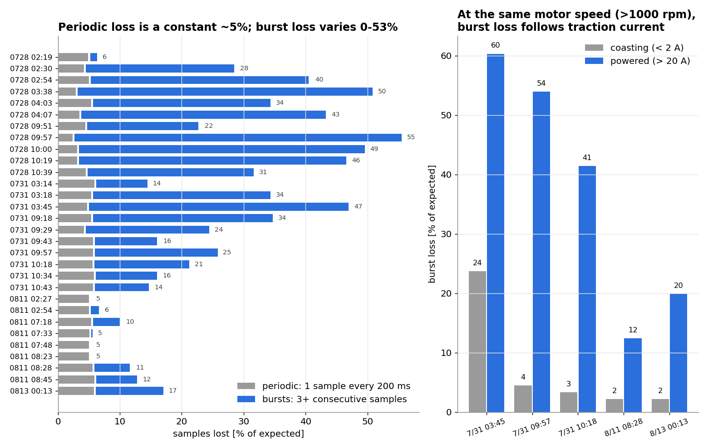

# 주행 로그 후처리: 영상으로 계측 시스템 검증하기

2026년 7~8월 주행 로그(세션 25개, 약 178만 행)와 온보드 영상(15개, 854×480, 15fps)만으로 계측 시스템을 검증했다. 추가 센서나 차량 재시험은 쓰지 않았다.

## 핵심 결과

| 항목 | 결과 |
| --- | --- |
| 영상–로그 동기 오차 | 세션마다 0.6~2.0초. 세션 안에서는 ±0.03초로 일정 |
| 채널 오류 | 8/11 오후부터 FL↔RR 라벨 뒤바뀜, 7/31 03:45 세션 6분 7초에 FL 고장 |
| 주기적 샘플 손실 5% | 원인은 서버 로그 저장 필터. 수정 후 재현 테스트 손실 0 ([커밋](../server/udp_logger/log_downsample.py)) |
| 전송 실패 손실 | Pi가 실패한 배치를 버림. 재전송 추가 후 2초 단절 모의에서 200 → 0 샘플 |
| 카메라 요레이트 | 랩 닫힘 조건으로 자기 교정. 6랩 적분 오차 30~192m → 18~27m |
| 차량 특성 | 롤 1.2~1.3 deg/g(영상), 언더스티어 K 0.0034~0.0044 s²/m² |
| 전류 센서 | 인버터 전류가 BMS 전류의 1.22~1.30배. 어느 쪽이 맞는지는 이 데이터로 판정 불가 |

### 영상으로 찾은 동기 오차


### 세션별 채널 상태 (횡가속도 상관)


### 샘플 손실 분해


### 카메라를 자이로 대신 쓰기


그 밖의 그림: FL 고장 시점(`fig2`), 라벨 교정 전후 롤 응답(`fig4`), g-g·댐퍼 속도·스펙트럼(`fig6`), GPS 없는 코스 복원(`fig8`), 최고·최저 랩 비교(`fig9`), 언더스티어 모델(`fig11`), 코너별 편차(`fig12`).

## 방법 요약

- **포텐셔미터 영상 추적** (`track_pots.py`): 양 끝 초록 부품을 HSV로 분리해 두 마커 사이 픽셀 거리를 변위 대용값으로 쓴다.
- **시간 오프셋** (`sync_check.py`, `estimate_offset.py`): 영상 신호와 로그를 시간으로 옮겨 가며 교차상관한다. 서스펜션이 안 보이는 영상은 지평선 띠의 좌우 이동(요)을 횡가속도÷차속과 맞춘다.
- **시간축 복원** (`common.py`): STM 시각을 서버 수신 시각의 하한에 선형 맞춤. STM 시계는 내부 RC 발진기라 0.6~0.8% 빠르다.
- **세션 점검** (`session_check.py`): 손실 분류, 죽은 채널, 좌우 라벨 일관성, 가속도·조향 부호, 전류 센서 불일치를 자동 점검. 결과 예시는 `results/session_check.md`.

## 실행

원본 로그와 영상은 용량 때문에 저장소에 넣지 않았다. 데이터 폴더(`udp_logger/logs`, `udp_realtime/camera_recordings`가 든 폴더)를 `AFA_DATA`로 지정한다. 스크립트는 `$AFA_DATA/_analysis` 안에서 실행하고, 중간 결과를 그 아래 `out/`, `clean/`에 쓴다.

```bash
export AFA_DATA=/path/to/afa_data
mkdir -p $AFA_DATA/_analysis/out $AFA_DATA/_analysis/clean
cp analysis/scripts/*.py $AFA_DATA/_analysis/ && cd $AFA_DATA/_analysis
python3 session_check.py --all          # 세션 점검표 -> out/session_check.md
python3 track_pots.py $AFA_DATA/udp_realtime/camera_recordings/camera-<id>.mp4 out/pots_0731_034542.csv
python3 sync_check.py                   # 7/31 영상-로그 오프셋
python3 clean.py                        # 정제 데이터셋 -> clean/
```

필요 패키지: `numpy`, `pandas`, `matplotlib`, `opencv-python`.

## 한계

- 수정한 코드는 재현 테스트로만 검증했다. 실제 주행에서의 손실률 개선은 확인하지 못했다.
- 영상 해상도 때문에 영상–로그 잔차가 약 2.4mm 남고, 7Hz 이상 움직임은 볼 수 없다. 픽셀→mm 환산은 로그에 맞춰 구해서 절대 크기의 독립 검증은 아니다.
- 펌웨어가 변위에 지수이동평균(차단 약 2.3Hz)을 걸어 댐퍼 거동은 분석하지 못했다.
- 롤 그래디언트와 언더스티어 계수는 설계값과 대조하지 못했다.
- 루트 README와 다른 수치가 있다. 손실률은 README의 5~10%가 아니라 세션에 따라 5~55%이고, 인버터 전류 1.25 보정은 어느 센서에 적용해야 하는지 검증되지 않았다.
