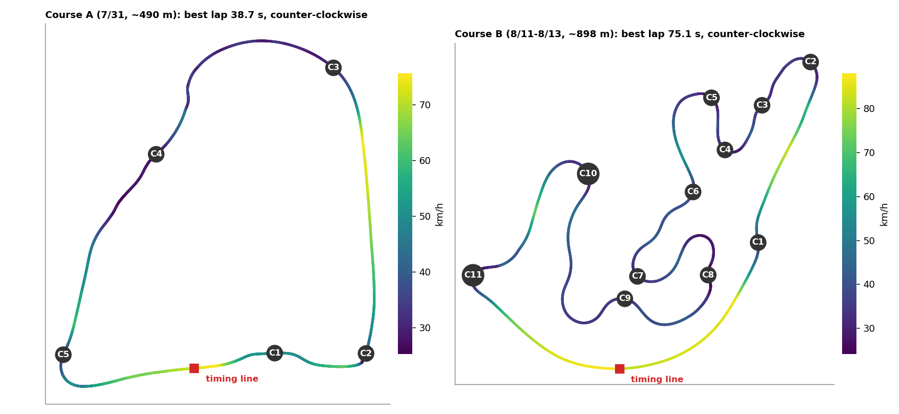
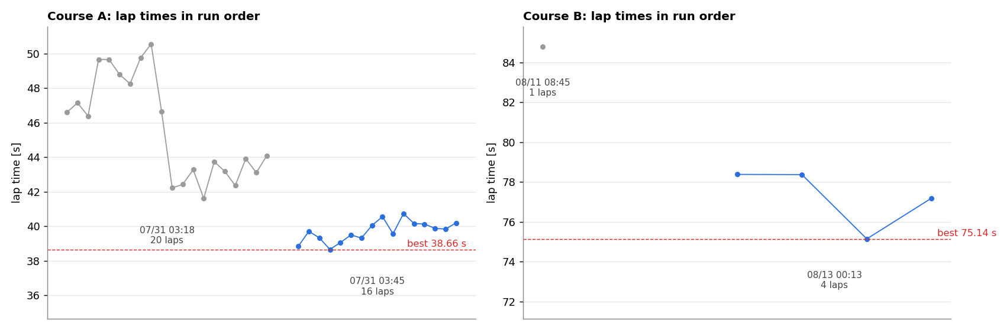
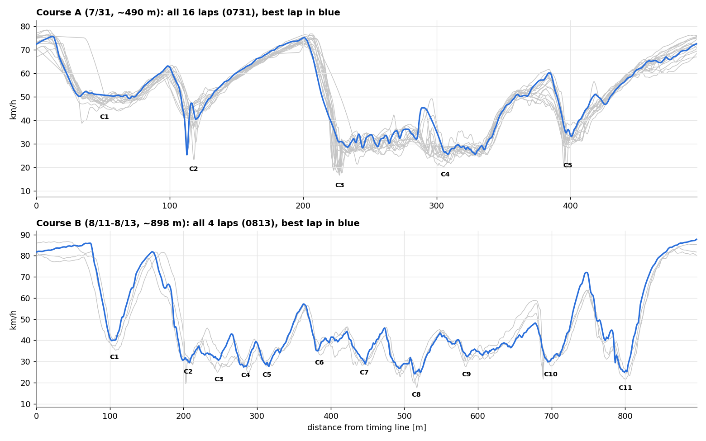
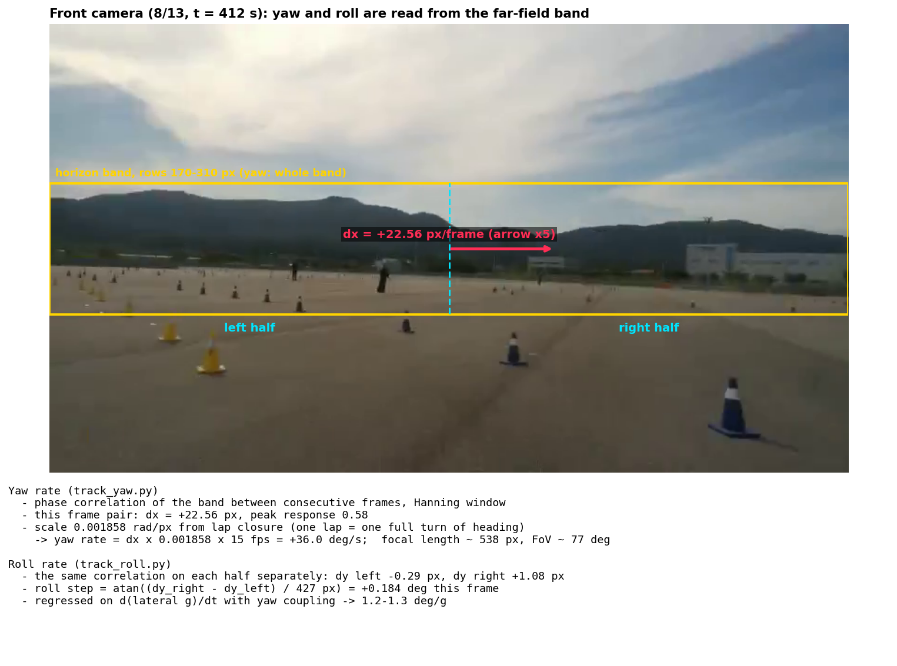

# 주행 로그 후처리: 영상으로 계측 시스템 검증하기

2026년 7~8월 주행 로그(세션 25개, 약 178만 행)와 온보드 영상(15개, 854×480, 15fps)만으로 계측 시스템을 검증했다. 추가 센서나 차량 재시험은 쓰지 않았다.

## 핵심 결과

| 항목 | 결과 |
| --- | --- |
| 영상–로그 동기 오차 | 세션마다 0.6~2.0초. 세션 안에서는 ±0.03초로 일정 |
| 채널 오류 | 8/11 오후부터 FL↔RR 라벨 뒤바뀜, 7/31 03:45 세션 6분 7초에 FL 고장 |
| 주기적 샘플 손실 5% | 원인은 서버 로그 저장 필터. 수정 후 재현 테스트 손실 0 ([커밋](../server/udp_logger/log_downsample.py)) |
| 전송 실패 손실 | Pi가 실패한 배치를 버림. 재전송 추가 후 2초 단절 모의에서 200 → 0 샘플 |
| 카메라 요레이트 | 랩 닫힘 조건으로 자기 교정. 6랩 적분 오차 30~192m → 18~27m |
| 차량 특성 | 롤 1.2~1.3 deg/g(영상), 언더스티어 K 0.0034~0.0044 s²/m² |
| 전류 센서 | 인버터 전류가 BMS 전류의 1.22~1.30배. 어느 쪽이 맞는지는 이 데이터로 판정 불가 |

### 영상으로 찾은 동기 오차


### 세션별 채널 상태 (횡가속도 상관)


### 샘플 손실 분해


### 카메라를 자이로 대신 쓰기


## 코스와 랩 타임 (GPS 없이)

주행 로그에서 폐회로 코스 두 개를 찾아 41랩을 계측했다 (`course_all.py`, `course_detail.py`).

1. 차속과 횡가속도로 곡률을 구해 0.5m 간격 거리축에 놓는다.
2. 곡률 자기상관의 최대에서 랩 길이를 찾는다.
3. 다음 랩과 가장 잘 맞는 랩을 기준으로, 곡률과 속도 무늬를 세션 전체에 대어 랩 경계를 찾는다.
4. 기준선을 메인 직선의 최고속 지점으로 고정하고, 나가고 들어오는 랩(중앙값의 112% 초과)과 데이터 공백 2.5초 초과 랩은 뺀다.



| 코스 | 랩 길이 | 방향·코너 | 계측 랩 | 최고 랩 | 이론상 최고 |
| --- | --- | --- | --- | --- | --- |
| A (7/31) | ~495 m | 반시계, 5개 (모두 좌) | 36 (03:18 20, 03:45 16) | 38.66 s | 37.95 s |
| B (8/11·8/13) | ~898 m | 반시계, 11개 (좌 8, 우 3) | 5 (8/11 1, 8/13 4) | 75.14 s | 73.88 s |

이론상 최고는 코너 구간별 최고 기록의 합. 같은 코스 판정은 한 랩 속도 무늬의 일치도(7/31 두 세션 0.95, 8/11–8/13 0.76).



| 세션 | 랩 | 최고 | 중앙값 | 표준편차 | 랩당 에너지 | 배터리 최고 온도(끝) |
| --- | --- | --- | --- | --- | --- | --- |
| A 7/31 03:18 | 20 | 41.62 s | 45.24 s | 3.00 s | 76 Wh | 37 °C |
| A 7/31 03:45 | 16 | 38.66 s | 39.78 s | 0.59 s | 89 Wh | 46 °C |
| B 8/11 08:45 | 1 | 84.80 s | – | – | 180 Wh | 40 °C |
| B 8/13 00:13 | 4 | 75.14 s | 77.78 s | 1.53 s | 177 Wh | 33 °C |

- 코스 A는 같은 날 두 번째 세션에서 중앙값 12% 단축, 편차 3.00 → 0.59 s. 03:45 후반에는 0.5~1.5 s 느려졌고, 그동안 배터리 온도 39 → 46 °C, 랩당 에너지 약 92 → 85 Wh. 원인은 가르지 못했다.
- 코스 B는 8/11 84.8 s → 8/13 75.14 s (−11%).



코너별 진입·최저·탈출 속도, 반경, 최대 횡·제동 g, 랩 간 편차는 `results/corners_courses.csv`. 랩 타임이 가장 흔들리는 코너는 B C11(0.65 s, 메인 직선 직전), A C4(0.64 s), B C3(0.53 s).

주의: 기준선은 실제 출발선이 아니고 수기 기록과 대조하지 못했다. 거리는 모터 회전수 기반 차속의 적분이라 약 3% 길게 잡혔을 수 있다. 좌우는 영상으로 정했다(가속도계 횡방향 부호가 7/31과 8/11 사이에 뒤집힘).

| 주행 성능 | 값 |
| --- | --- |
| 최대 횡가속도 (상위 1%, 8/11~8/13) | 0.96~1.49 g |
| 최대 제동 / 가속 | 0.72~1.00 g / 0.34~0.70 g |
| 최고 속도 | 64~91 km/h |
| 에너지 소모 (8/13) | 6.4 km, 1.20 kWh, 188 Wh/km |
| 최대 출력·토크 지령 (상위 0.1%) | 약 52 kW, 231 Nm |
| 최고 온도 | 인버터 43 °C, 모터 52 °C, 배터리 셀 49 °C |

에너지와 출력은 BMS 전압×전류 기준이다. 인버터와 BMS 전류가 약 25% 달라서 실제 값은 더 클 수 있다.

그 밖의 그림: FL 고장 시점(`fig2`), 라벨 교정 전후 롤 응답(`fig4`), g-g·댐퍼 속도·스펙트럼(`fig6`), 초기 랩 분석(`fig8`, `fig9`, `fig12`, 기준선 고정 전), 언더스티어 모델(`fig11`).

## 방법 요약

### 영상에서 무엇을 재는가

전륜 포텐셔미터: 양 끝 초록 부품 네 개의 중심을 찾고, 같은 포텐셔미터의 두 마커 사이 픽셀 거리를 변위 대용값으로 쓴다. 차체에 고정된 안쪽 두 마커의 간격으로 잘못 잡힌 프레임을 거른다.


전방 카메라: 지평선 띠(행 170~310)의 프레임 간 좌우 이동으로 요레이트를, 좌우 절반의 상하 이동 차이로 롤 변화를 잰다.



- **포텐셔미터 영상 추적** (`track_pots.py`): 양 끝 초록 부품을 HSV로 분리해 두 마커 사이 픽셀 거리를 변위 대용값으로 쓴다.
- **시간 오프셋** (`sync_check.py`, `estimate_offset.py`): 영상 신호와 로그를 시간으로 옮겨 가며 교차상관한다. 서스펜션이 안 보이는 영상은 지평선 띠의 좌우 이동(요)을 횡가속도÷차속과 맞춘다.
- **시간축 복원** (`common.py`): STM 시각을 서버 수신 시각의 하한에 선형 맞춤. STM 시계는 내부 RC 발진기라 0.6~0.8% 빠르다.
- **세션 점검** (`session_check.py`): 손실 분류, 죽은 채널, 좌우 라벨 일관성, 가속도·조향 부호, 전류 센서 불일치를 자동 점검. 결과 예시는 `results/session_check.md`.

## 실행

원본 로그와 영상은 용량 때문에 저장소에 넣지 않았다. 데이터 폴더(`udp_logger/logs`, `udp_realtime/camera_recordings`가 든 폴더)를 `AFA_DATA`로 지정한다. 스크립트는 `$AFA_DATA/_analysis` 안에서 실행하고, 중간 결과를 그 아래 `out/`, `clean/`에 쓴다.

```bash
export AFA_DATA=/path/to/afa_data
mkdir -p $AFA_DATA/_analysis/out $AFA_DATA/_analysis/clean
cp analysis/scripts/*.py $AFA_DATA/_analysis/ && cd $AFA_DATA/_analysis
python3 session_check.py --all          # 세션 점검표 -> out/session_check.md
python3 track_pots.py $AFA_DATA/udp_realtime/camera_recordings/camera-<id>.mp4 out/pots_0731_034542.csv
python3 sync_check.py                   # 7/31 영상-로그 오프셋
python3 clean.py                        # 정제 데이터셋 -> clean/
```

필요 패키지: `numpy`, `pandas`, `matplotlib`, `opencv-python`.

## 한계

- 수정한 코드는 재현 테스트로만 검증했다. 실제 주행에서의 손실률 개선은 확인하지 못했다.
- 영상 해상도 때문에 영상–로그 잔차가 약 2.4mm 남고, 7Hz 이상 움직임은 볼 수 없다. 픽셀→mm 환산은 로그에 맞춰 구해서 절대 크기의 독립 검증은 아니다.
- 펌웨어가 변위에 지수이동평균(차단 약 2.3Hz)을 걸어 댐퍼 거동은 분석하지 못했다.
- 롤 그래디언트와 언더스티어 계수는 설계값과 대조하지 못했다.
- 루트 README와 다른 수치가 있다. 손실률은 README의 5~10%가 아니라 세션에 따라 5~55%이고, 인버터 전류 1.25 보정은 어느 센서에 적용해야 하는지 검증되지 않았다.
